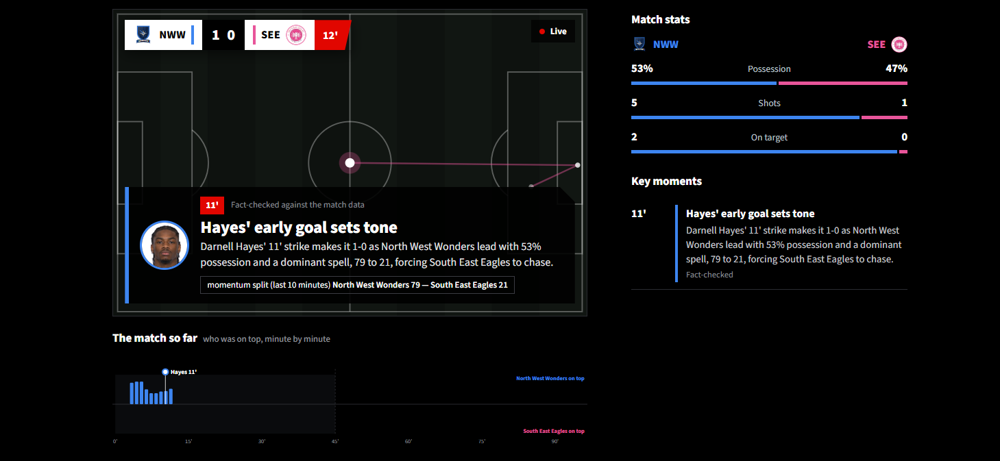
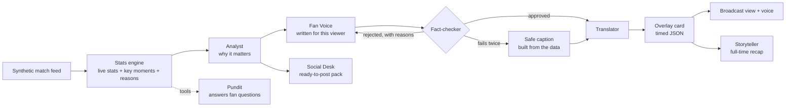

# Matchday Social Desk

**A team of AI agents that watches a football match live and tells its story differently for every fan:
on screen, out loud, in any language and on social media. Every number is fact-checked against the data.**

Built for the Microsoft x Premier League _Inside the Game: Developer Hackathon_, challenge:
_The Synthetic Match Insights Engine for Premier League Studio_.



▶ **Demo video:** [Watch on YouTube](https://www.youtube.com/watch?v=mMBdd2H4dCs)

---

## The problem

A match produces thousands of events, but studios, streaming apps and club social teams all need
something different from them, and they need it in seconds. Stats feeds say _what_ happened. Fans want to
know _why it matters_, in their own words, in their own language, about their own club and players. And any
AI that writes about live sport has to be trusted not to invent numbers.

## What it does

Matchday Social Desk replays a synthetic match as a live feed and runs it through one pipeline with five
stages, exactly as the challenge asks:

| Stage           | What happens                                                                                                                                                                                                                                                    | Where                 |
| --------------- | --------------------------------------------------------------------------------------------------------------------------------------------------------------------------------------------------------------------------------------------------------------- | --------------------- |
| **Ingest**      | Events (passes, shots, tackles, pressures, possession changes) arrive one at a time, like a live feed                                                                                                                                                           | `stats_engine.py`     |
| **Interpret**   | A stats engine keeps a live picture of the match: possession, pass accuracy, a 1 to 10 pass difficulty rating, xG, ball and shot speed, pressing, a momentum meter and a "control vs chaos" index. It flags key moments and records the reasons behind each one | `stats_engine.py`     |
| **Explain**     | An Analyst agent explains _why_ each moment matters (momentum, pressing, control vs chaos, game rhythm) using only the engine's numbers                                                                                                                         | `agents.py`           |
| **Render**      | Timed, machine-readable overlay cards (JSON) for a broadcast graphics engine, shown in a broadcast-style interface with a score bug, lower-third captions and a momentum timeline                                                                               | `agents.py`, `app.py` |
| **Personalise** | The same moment becomes a different experience for an analyst, a casual fan or a social feed, in 8 languages, for a favourite club or player, or in player focus mode                                                                                           | `agents.py`, `app.py` |

### Features

- **Live broadcast view**: a score bug, ball trail, lower-third captions that appear at the right minute, and a
  "who was on top" momentum timeline with every key moment pinned to it.
- **Personalised for every fan**: viewing mode (Casual fan, Analyst, Social feed), language, favourite club,
  favourite player and **player focus mode**. Casual fans see 3 simple stats; analysts see 8 plus a chaos meter.
- **No spoilers**: each moment is analysed only with the stats as they stood at that minute.
- **Fact-checked**: every caption is checked against the match data before it is shown.
- **Ask the pundit**: at half-time and full-time, fans ask questions in plain English. A tool-using agent
  looks up the stats it needs before answering, and can't see beyond the current minute.
- **Social Desk**: every big moment becomes a ready-to-post package (hook, caption, on-screen text, format idea,
  best platform) plus a branded 1080x1350 post to download. A content team in a box for clubs.
- **Optional voice commentary**: a natural British commentator voice reads each caption aloud.
- **Synthetic data generator**: creates a complete, football-realistic 90-minute match with a built-in story.

---

## The agent team



| Agent            | Job                                                                                                                                                                                                                                                                                                                                                                                                          |
| ---------------- | ------------------------------------------------------------------------------------------------------------------------------------------------------------------------------------------------------------------------------------------------------------------------------------------------------------------------------------------------------------------------------------------------------------ |
| **Analyst**      | Explains why a moment matters, using only numbers from the stats engine                                                                                                                                                                                                                                                                                                                                      |
| **Fan Voice**    | Rewrites the insight for one viewer: analyst, casual fan or social caption; favourite club and player                                                                                                                                                                                                                                                                                                        |
| **Fact-checker** | A two-step check. First a fast rule check: every number must exist in the match data (sensible rounding allowed), with no data field names or team codes. Then an AI check of names, claims and spoilers. Rejected captions go back to Fan Voice with the reasons. If a caption fails twice, a safe caption built straight from the data is shown instead, so **nothing unverified ever reaches the screen** |
| **Translator**   | Translates the approved caption, keeping names and numbers unchanged                                                                                                                                                                                                                                                                                                                                         |
| **Storyteller**  | Writes the full-time recap and picks a player of the match                                                                                                                                                                                                                                                                                                                                                   |
| **Social Desk**  | Turns big moments into ready-to-post social packages                                                                                                                                                                                                                                                                                                                                                         |
| **Pundit**       | Answers fans' questions with **tool calling** (`get_match_stats`, `get_player_stats`, `get_key_moments`, `list_players`), limited to the current minute                                                                                                                                                                                                                                                      |

The **Orchestrator** decides which moments each viewer sees, runs the agents in order, manages the
rewrite loop, and keeps an audit trail of what every agent did (shown in the app at full-time). Before
kick-off it **warms up**, preparing every moment in parallel so the match then plays smoothly.

---

## Microsoft technology

| Technology                        | How it's used                                                                                                   |
| --------------------------------- | --------------------------------------------------------------------------------------------------------------- |
| **Microsoft Foundry**             | Hosts the models. `gpt-5-mini` powers all seven agents; `gpt-audio-mini` provides the natural commentator voice |
| **Azure OpenAI (Foundry Models)** | Chat completions with JSON output for the agents; function calling for the Pundit; audio output for the voice   |
| **Azure AI Speech**               | Neural text to speech as the fallback commentator voice, in 7 languages                                         |
| **GitHub**                        | Source control and project hosting                                                                              |
| **GitHub Copilot**                | Used in VS Code while building the project                                                                      |

---

## Overlay output

Every caption is also produced as a timed, machine-readable card that a broadcast graphics engine could
render over a live feed:

```json
{
  "card_id": "008",
  "show_at_clock_s": 4332.3,
  "duration_s": 8,
  "display_minute": "73'",
  "moment_type": "goal",
  "team": "NWW",
  "player": "Ollie Khan",
  "theme": "momentum",
  "title": "Khan doubles the lead",
  "body": "Ollie Khan finishes from close range. It's 2-0, and the Eagles' brief spell on top is over.",
  "stat_chip": { "label": "Shot speed", "value": "81.8 km/h" },
  "verified": true,
  "language": "English"
}
```

Download the full set from the app at full-time, or run `python agents.py` to write
`output/overlay_cards.json`.

---

## The data

All data is **synthetic**. No real Premier League data is used. `generate_match.py` creates a
football-realistic 90-minute match between two fictional London clubs, **North West Wonders** and
**South East Eagles**: about 2,000 events including passes (with length, ball speed and pressure), shots
(with distance, xG and shot speed), tackles, interceptions, pressures, fouls, corners and saves. The match has
a scripted story (the home side controls early, the away side grows into it, then a late home push), so the
agents have something real to explain.

```
python generate_match.py            # the default match
python generate_match.py --seed 7   # a different match
```

Each event looks like this:

```json
{
  "event_id": 29,
  "period": 1,
  "clock_s": 87.3,
  "minute": 1,
  "team": "NWW",
  "player": "Darnell Hayes",
  "type": "pass",
  "x": 103,
  "y": 9.7,
  "end_x": 103,
  "end_y": 2,
  "length_m": 7.7,
  "ball_speed_kmh": 49.0,
  "under_pressure": false,
  "outcome": "complete",
  "recipient": "Harvey Okonjo"
}
```

---

## Run it yourself

**You need:** Python 3.10+, and a Microsoft Foundry project with a `gpt-5-mini` deployment.
`gpt-audio-mini` is optional, for the natural voice.

```
git clone https://github.com/georgiajayy/matchday-social-desk.git
cd matchday-social-desk
python -m venv .venv
.venv\Scripts\activate            # Windows   (macOS/Linux: source .venv/bin/activate)
pip install -r requirements.txt
```

Copy `.env.example` to `.env` and fill in your own values. Then:

```
python test_ai.py          # check the connection to Microsoft Foundry
streamlit run app.py       # open the app and press Kick off
```

**No Azure account?** Set `MOCK_AI=1` in `.env` to run the whole app offline with placeholder text.

### Project structure

```
app.py              Broadcast interface (Streamlit): live replay, warm-up, social desk, pundit chat
agents.py           The agent team and the orchestrator
stats_engine.py     Live stats, momentum, chaos index, pass difficulty, key moments
pundit.py           Tool-using "Ask the pundit" agent
voice.py            Commentator voice (gpt-audio-mini, with Azure AI Speech as fallback)
graphics.py         Crests, player graphics and social post images
generate_match.py   Synthetic match generator
assets/             Club crests (and the script that draws them) and squad headshots
data/               The generated match
```

---

## Responsible AI

- **Synthetic, fictional data only.** All clubs, players, venues and events are made up.
- **Grounded output.** Agents may only use numbers calculated by the stats engine. The Fact-checker blocks
  anything else, and the safe fallback means unverified claims are never shown.
- **No spoilers.** Live captions and the half-time pundit can only see the match up to the current minute.
- **Transparency.** Captions show whether they were fact-checked; the full-time audit trail shows every agent
  step, and the pundit shows which stats it checked.
- **Original artwork.** The club crests are drawn in code (`assets/make_crests.py`). The squad headshots are
  **AI-generated images of fictional people** and do not depict real players. Logos are kept out of shot.

## What's next

- Ingest a real-time event stream (for example through Azure Event Hubs) instead of a replayed file.
- Auto-eventing: generate pass and speed metrics from a video feed with a vision model.
- Deploy to Azure Container Apps, with the overlay cards served as an API for graphics partners.
- Split-screen mode: two fans, one match, side by side.

---

Built by **Georgia Summers**, with the help of AI coding assistants, including GitHub Copilot.
